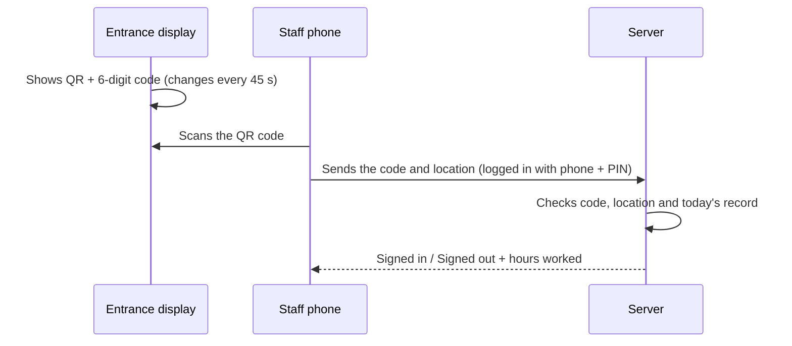

Staff Attendance: QR Code Sign-in / Sign-out
A self-hosted attendance system for small and mid-sized teams (20–100 staff, one location). Staff scan a rotating QR code at the entrance with their own phones to sign in, and scan again to sign out. The system records the time in, the time out and the hours worked, and gives admins a live dashboard and monthly reports.
It runs on a single server: Node.js, Express and SQLite. There is no external database and no cloud dependency, and all checks run on the server.
<!-- SCREENSHOTS: add your images to the docs/ folder, then remove this comment line and the closing line below to show them.

## Screenshots

| Staff phone | Entrance display |
|---|---|
|  |  |

| Admin dashboard | Monthly report |
|---|---|
|  |  |

How it works

The first valid scan of the day is a sign-in. The second is a sign-out, and the server calculates the hours. A third scan is refused, so there is one sign-in and one sign-out per person per day.
Features
For staff
Log in with phone number and PIN, and stay signed in on their phone.
Scan the QR with the phone camera, or type the 6-digit code shown under it.
See today's status and the last 14 days (time in, time out, hours, flags).
Change their own PIN.
For admins
Live dashboard for any date: staff count, working now, signed out, absent and total hours.
Edit, create or delete any day's record, with all changes written to an audit log.
Monthly report per person: days present, total hours, average per day, late days, overtime and missing sign-outs, with CSV export.
Late, overtime and "no sign-out" flags based on the working hours and grace period you set.
Add staff, reset PINs, and remove staff (history is kept).
Optional location check: scans must come from within a set radius of the office.
Company branding: name, brand color and logo, applied across the whole app.
Entrance display page that shows only the QR code, opened through a private link with no login.
Security
The server enforces everything; nothing depends on the browser behaving honestly.
Rotating code: a 6-digit code derived from a secret that never leaves the server. It changes every 45 seconds, and the previous code is accepted for a short grace period, so a code is valid for 45–90 seconds. A photo of the QR sent to a colleague quickly becomes useless.
One record per person per day: enforced by a database rule, so quick double taps cannot create duplicates. Sign-out is blocked for the first minute after sign-in.
PINs: stored as salted scrypt hashes, never in plain text.
Login lockout: 5 failed attempts lock that phone number and that IP address for 15 minutes.
Sessions: random 256-bit tokens in `HttpOnly`, `SameSite=Strict` cookies (also `Secure` over HTTPS), valid for 30 days.
Entrance display link: protected by a random 128-bit key. It can be regenerated at any time from Settings.
Audit log: admin edits, staff changes, setting changes and logo changes are recorded.
Uploads: logos are checked by file signature rather than file name, are size-limited, and are served with a restrictive content security policy.
CSV export: protected against spreadsheet formula injection.
Known limitations
Location comes from the phone, so a determined person could fake it. The rotating code is the main safeguard, and the location check adds friction. Phones only share location over HTTPS.
A live relay still works. Someone could stream the entrance screen to a colleague in real time. The 45-second rotation limits this but cannot fully stop it. Pair the system with a physical check such as the screen being in view of reception.
PINs are 4–6 digits, so protection relies on the lockout. The lockout counters are kept in memory and reset when the server restarts.
No built-in HTTPS. Put the app behind a reverse proxy such as Caddy or Nginx.
Only the first account is an admin, and there is no UI yet for promoting others.
The database contains staff names, phone numbers and attendance history. Protect and back up `attendance.db`, and never commit it to a repository.
Requirements
Node.js 20 or newer (LTS recommended)
Windows 10/11 or Linux (Ubuntu 22.04 / 24.04 tested paths below)
For real use: a domain name and HTTPS
Install on Windows (testing or small setups)
Open PowerShell and run:
```powershell
winget install OpenJS.NodeJS.LTS
```
Close PowerShell and open a new window. If `npm` reports that running scripts is disabled, run this once:
```powershell
Set-ExecutionPolicy -Scope CurrentUser -ExecutionPolicy RemoteSigned
```
Then, in the project folder:
```powershell
npm install --omit=dev
$env:TZ_NAME="Africa/Accra"
node server.js
```
The server prints `Attendance server on :3000`. Open `http://localhost:3000`.
To reach it from phones on the same Wi-Fi, allow the port through the firewall (run once in an Administrator PowerShell), then browse to `http://<computer-ip>:3000`:
```powershell
New-NetFirewallRule -DisplayName "Attendance 3000" -Direction Inbound -LocalPort 3000 -Protocol TCP -Action Allow
```
Over plain HTTP, phones block the location check, so everything except location can be tested this way. For always-on use, Linux is recommended.
Install on Ubuntu (production)
```bash
curl -fsSL https://deb.nodesource.com/setup_20.x | sudo -E bash -
sudo apt install -y nodejs build-essential python3
sudo mkdir -p /opt/attendance
sudo cp -r . /opt/attendance && cd /opt/attendance
sudo npm install --omit=dev
sudo useradd -r -s /usr/sbin/nologin attendance
sudo chown -R attendance:attendance /opt/attendance
```
Run as a service
Create `/etc/systemd/system/attendance.service`:
```ini
[Unit]
Description=Staff Attendance
After=network.target

[Service]
WorkingDirectory=/opt/attendance
Environment=APP_URL=https://attendance.yourcompany.com
Environment=TZ_NAME=Africa/Accra
ExecStart=/usr/bin/node server.js
Restart=always
User=attendance

[Install]
WantedBy=multi-user.target
```
```bash
sudo systemctl daemon-reload
sudo systemctl enable --now attendance
```
Add HTTPS with Caddy
Install Caddy, then put this in `/etc/caddy/Caddyfile` (your domain's DNS must point at the server, and ports 80 and 443 must be open):
```
attendance.yourcompany.com {
    reverse_proxy localhost:3000
}
```
```bash
sudo systemctl reload caddy
```
Caddy obtains and renews the certificate automatically.
Configuration
Variable	Default	Meaning
`PORT`	`3000`	Port the app listens on
`TZ_NAME`	`Africa/Accra`	Time zone used for "today" and all displayed times
`DB_FILE`	`./attendance.db`	Location of the SQLite database
`APP_URL`	request host	Public address placed inside the QR code
First-time setup
Open the site. The first screen creates the admin account.
Settings → Company branding: set the company name, brand color and logo.
Settings → Working hours: set start time, end time and grace minutes.
Settings → Location check: stand at the office, tap Use my current location, set the radius, and save. Leave it unset to turn the check off.
Staff: add each person with a phone number and a PIN. Adding an existing number resets that person's PIN.
Settings → Entrance display: open the private link on the entrance tablet or screen, set it to full screen, and keep it awake.
Test with a phone: scan, check the sign-in message, wait a minute, scan again, then review the Dashboard.
Backups
The whole system is one SQLite file. Take a consistent backup with:
```bash
sqlite3 /opt/attendance/attendance.db ".backup /backups/attendance-$(date +%F).db"
```
Run it nightly with cron and keep copies on another machine.
Project structure
```
server.js            API, authentication, rotating codes, reports (Express + SQLite)
package.json
public/
  index.html         Single-page web app (staff and admin screens)
  kiosk.html         Full-screen entrance display (QR code only)
docs/                Screenshots for this README
```
The database holds these tables: `staff`, `sessions`, `attendance`, `settings`, `audit` and `logo`.
API overview
Endpoint	Access	Purpose
`POST /api/login`, `/api/logout`	Public / signed in	Session handling
`POST /api/scan`	Signed in	Sign in or out with code and location
`GET /api/my`	Signed in	Your recent days
`POST /api/pin`	Signed in	Change your PIN
`GET /api/attendance?date=`	Admin	Day dashboard data
`PUT` / `DELETE /api/attendance`	Admin	Edit or delete a record
`GET /api/report?month=`	Admin	Monthly report (`&csv=1` for CSV)
`GET` / `POST /api/staff`, `DELETE /api/staff/:id`	Admin	Staff management
`GET` / `PUT /api/settings`	Admin	Hours, location, branding
`GET /api/kiosk?key=`	Private key	Current code for the entrance display
Roadmap
Leave and holiday tracking in monthly reports
Night shifts and multiple sessions per day
Office network (IP) check as an extra to location
Multiple admins
Email summaries
Docker image
Troubleshooting
`npm install` fails on `better-sqlite3`: make sure you are on a current Node.js LTS release. On Linux install `build-essential` and `python3`.
Phone cannot open the site: check the server firewall, and that the phone and server are on the same network.
Location is not requested or fails: the site must be served over `https://`, and location permission must be allowed for the browser.
Wrong times displayed: set `TZ_NAME` to your IANA time zone, for example `Africa/Accra`, and restart.
Logs on Linux: `sudo journalctl -u attendance -f`
